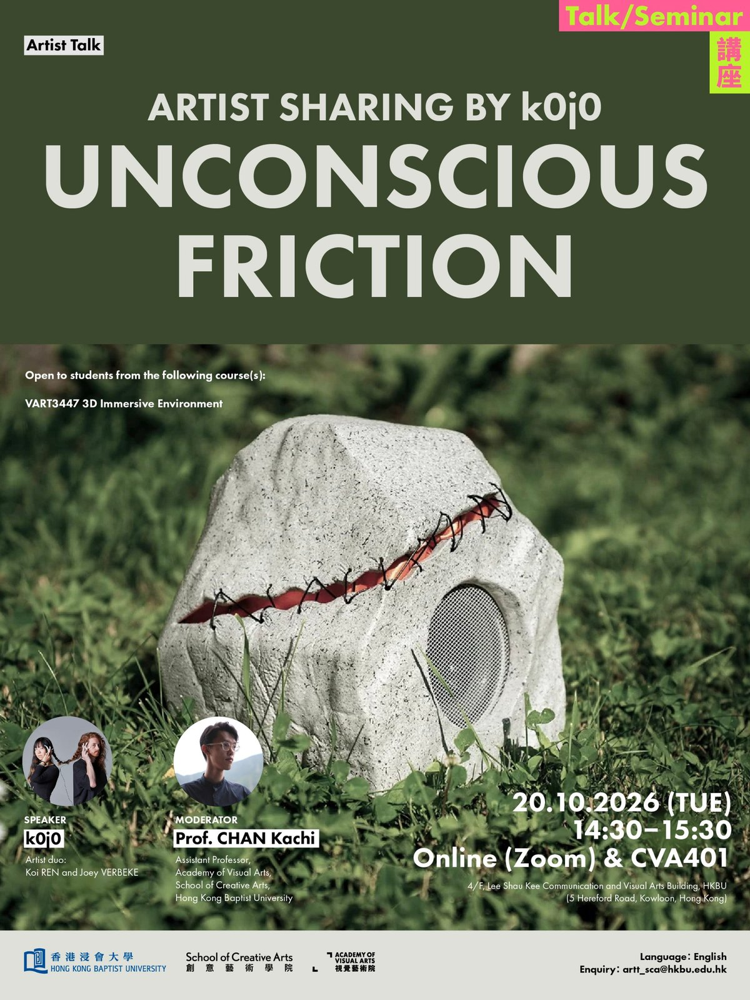
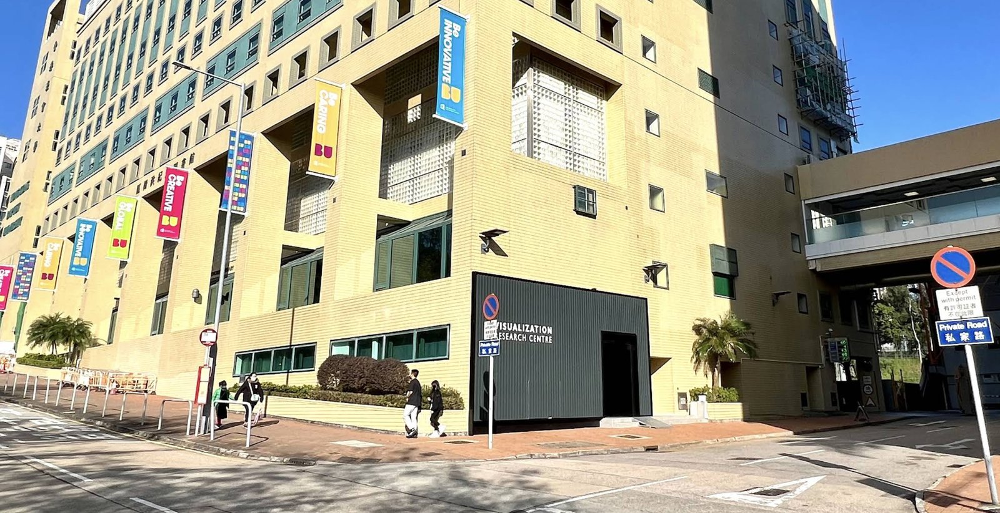

<!--
Drafted 6 Oct 2026. Updated 19 Oct 2026: talk details from the poster set, VRC visit added.
IMAGES: assets/img/week07/ — 01-poster.jpg (IG P1), 03-vrc-entrance.jpg (photo of the VRC entrance).
IG P2 (speaker) and P3 (talk) are not embedded; their text is in "About the talk" and "About the speaker" below.
TODO: Zoom link not added.
-->

# Week 7 · Artist Sharing

**Tuesday 20 October.** Two things today: an artist talk, then a visit to the Visualization Research Centre.

| | |
|---|---|
| **14:30–15:30** | Artist talk: ***Unconscious Friction*** by k0j0. **CVA401** or online (Zoom) |
| **16:50** | **Gather at the VRC entrance**, Luen Fuk Road |
| **17:00** | Visit: **Visualization Research Centre** |

## 1 · Artist talk: *Unconscious Friction*

| | |
|---|---|
| Where | **CVA401**, 4/F, Lee Shau Kee Communication and Visual Arts Building (5 Hereford Road). Also online on Zoom |
| When | 14:30–15:30 |
| Speaker | **k0j0**, artist duo Koi Ren and Joey Verbeke · [k0j0.com](https://www.k0j0.com) |
| Moderator | Kachi Chan |
| Language | English |

### About the talk

Seamless interfaces promise to remove friction, but what tensions do they conceal, and whose interests does their smoothness serve? This talk explores friction and unconscious friction at the intersection of perception, agency, and technological mediation, examining how interfaces and the systems behind them shape thought and behaviour beneath conscious awareness. It considers friction both as a condition to investigate and as an artistic method for making hidden dynamics felt. Drawing on k0j0's research and interactive works, the discussion connects the politics of interface design with the practice of creating within these same systems, asking how critical encounters can unsettle technological futures presented as inevitable.

### About the speaker

k0j0 is an artist duo formed by Koi Ren and Joey Verbeke. Drawing on human-computer interaction, artificial intelligence, media studies and speculative design, they build "intrafaces": interactive works that expose the power and politics built into everyday systems of interaction. Their work has been shown at Ars Electronica, SIGGRAPH, the Asia Culture Center (Gwangju), MUTEK, Gray Area and the Sundance Film Festival New Frontier. They are incoming Evermay Future Fellows (2027).

**Website: [k0j0.com](https://www.k0j0.com)**

## 2 · Visit: Visualization Research Centre

**Gather at 16:50** at the VRC entrance on **Luen Fuk Road**. The visit starts at **17:00** and we go in together, so be there on time.

**[Open in Google Maps](https://maps.app.goo.gl/B7geniLijkcuAkzY9)**

Look for the **black wall** with **Visualization Research Centre** on it.

---

**Next week is the mid-term.** Brief, timetable and rules on the [week 8 page](week08.md).
